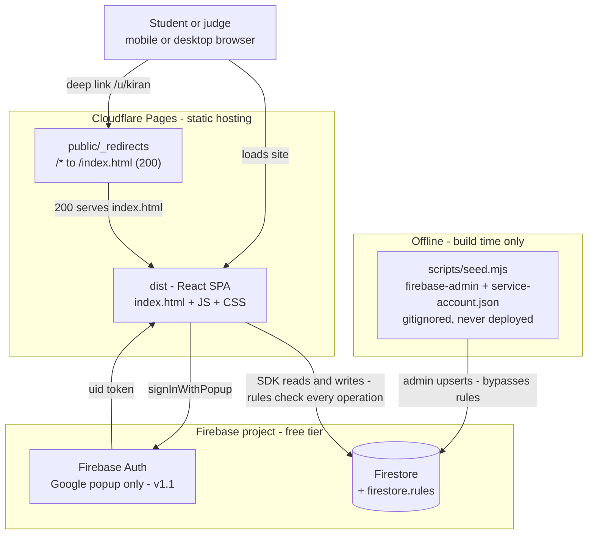
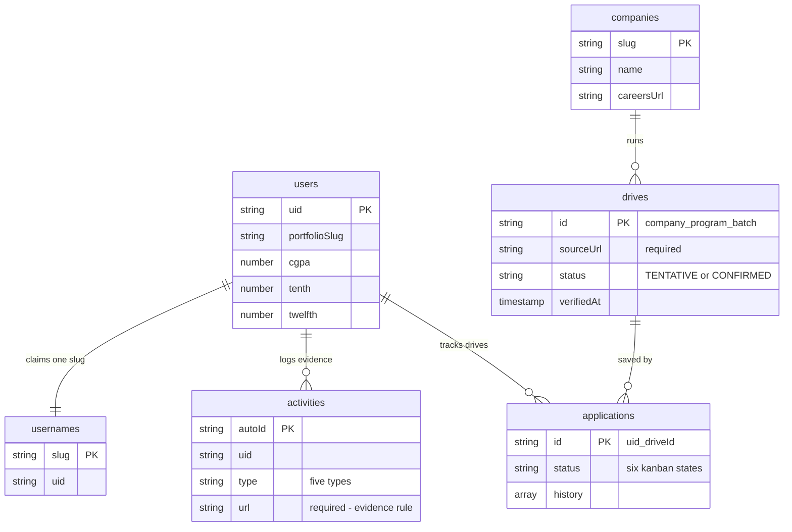
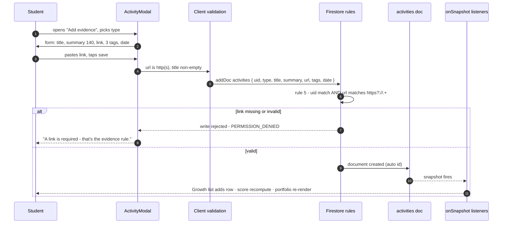

# DriveDeck — Architecture.md

**The blueprint set.** Everything below is written to be sufficient to construct the product by hand: read this file alone, build what it says, and the result is DriveDeck. It is organized the way a civil engineering drawing set is organized — title sheet, design codes, site plan, foundation, structure, floor plan, plumbing, construction sequence, specifications, commissioning — because that is the order a building is actually built in, and this product is built the same way: foundation first, decorations never load-bearing.

| | |
|---|---|
| **Revision** | v1.1 · 2026-11-08 — adds `/resources` route (public), GitHub/LinkedIn URL fields on `users`, Google-only auth |
| **Status** | Pre-build — no code exists yet. Construction starts at Sheet 7, step 1. |
| **Companion file** | `PRD.md` (repo root, next to this file) — product specs: UI copy, acceptance criteria, seed values, design tokens |
| **Live target** | `drivedeck.pages.dev` — must stay up until hackathon results (Dec 6, 2026) |

---

## Sheet 0 — Title sheet: how to read this file

### 0.1 Project context (self-contained)

**DriveDeck** is a mobile-first web app for Indian engineering students from the 3rd year onward: a placement-prep tracker with verified drive deadlines, a kanban pipeline board, and a public live portfolio that builds itself from an evidence log. Tagline: **"From 3rd year to offer letter."** Built for the JioCoder Hackathon 2026 (submission Dec 1, 2026, 11:59 PM IST).

- **Persona:** Kiran — 3rd-year CSE, aspiring Data Analyst, Android phone, zero budget. One user, one persona; every decision is checked against Kiran.
- **Scope (locked):** 3 USPs (Verified Drive Tracker · Evidence-linked auto-Portfolio · Transparent Readiness Score) + 4 features (Dashboard · Drives · Board · Growth→Portfolio) + 2 support screens (Landing · Onboarding). Nothing else. The cut list with reasons is in `PRD.md` §14.
- **Stack (locked):** React 18 + Vite + Tailwind CSS SPA · Firebase Auth + Firestore · Cloudflare Pages. Five packages beyond React itself (Sheet 8). No server, no functions, no cron, ever.

### 0.2 Sources of truth (precedence order)

| # | Source | Owns |
|---|---|---|
| 1 | `firestore.rules` in the repo | Security rules. If any document disagrees, the rules file wins. |
| 2 | **This file** | All code-level architecture: routes, components, collections, IDs, lifecycles, conventions |
| 3 | `PRD.md` | All product-level detail: exact UI strings (§7), design tokens (§8), acceptance criteria (per feature §6), seed data values (§12) |

Where this file and `PRD.md` both speak about architecture (e.g. the rules, the collections), the copies are identical by design; if they ever drift, fix the lower-precedence copy to match the higher one.

### 0.3 Glossary (terms used with fixed meaning throughout)

| Term | Meaning |
|---|---|
| **Drive** | One placement hiring event by one company for one batch (e.g. TCS NQT 2027). Document ID: `company_program_batch`. |
| **TENTATIVE / CONFIRMED** | Drive row status. CONFIRMED only when the official source page itself states the date. TENTATIVE is displayed honestly, never as fact. |
| **Evidence** | One logged piece of real work (activity). Must carry a working `http(s)://` link — no link, no entry. |
| **Board** | The kanban: Saved · Applied · Test/OA · Interview · Offer · Rejected. One card = one application. |
| **Slug** | The portfolio URL name in `/u/:slug`. Claimed once, immutable forever. |
| **Readiness Score** | 0–100 computed from evidence: `min(100, 15·P + 10·C + 5·K + 2·D + min(10, 0.5·S))`. Printed publicly with its formula. |
| **Streak (S)** | Consecutive calendar days (ending today or yesterday) with ≥ 1 evidence entry. |
| **Match me** | Client-side eligibility filter: profile numbers vs drive `eligibility` map. |
| **Seeding** | Writing verified `companies`/`drives` via the Admin SDK script `scripts/seed.mjs` — the only path that can write drives. |

### 0.4 If you are an AI reading this file

You are being asked to understand, review, or continue the construction of DriveDeck. Hold these facts:

1. **The scope above is locked.** Do not propose features outside it; the answer to "why not build X?" is in `PRD.md` §14. Adding a server, a cron, file uploads, an AI feature, or a sixth runtime dependency is out of bounds — the entire architecture (Sheets 2–4) depends on their absence.
2. **Data writes go through Firestore security rules** (Sheet 4). There is no API layer to extend. Validation that matters lives in the rules, not the UI.
3. **IDs are deterministic** (Sheet 3.3). Never generate random IDs where a deterministic one exists — duplicate protection is the ID.
4. **Build in the Sheet 7 order.** Deploy on day one; the live link must exist from the first week.
5. **Match the established voice:** product strings come verbatim from `PRD.md` §7; never invent UI copy inline.

---

## Sheet 1 — Design codes & the case: why this architecture

Civil engineers build to code; the code is not a suggestion. This project has three codes, and every architectural decision below is checked against them:

| Code | Constraint |
|---|---|
| **C1** | One builder, ~3 weeks part-time |
| **C2** | ₹0 infrastructure — free tiers only, forever |
| **C3** | Trust is structural — verification and evidence are enforced by the data model, not promised by the UI |

**The case this blueprint proves** — three strands, one building:

### 1.1 Zero-backend (the engineering argument)

A stack like this needs, traditionally: an API server, CRUD endpoints, auth middleware, request validation, a deployment target for the server, and monitoring. DriveDeck replaces all of it with **~40 lines of Firestore security rules** (Sheet 4) plus the Firebase SDK in the browser.

| Concern | Traditional | DriveDeck |
|---|---|---|
| Authorization | Server middleware per endpoint | Rules evaluate every read/write, by identity and by document path |
| Validation | Server-side DTO checks | Rules check the *content* of writes (evidence URL regex, uid match) |
| Deployment | App + server + database | Static `dist/` on Cloudflare Pages + Firestore |
| Cost surface | N services to scale | 2 free tiers with hard caps (Sheet 8.4) |
| Attack surface | Every endpoint is a door | No doors: rules are the only gate, and rules are declarative |

### 1.2 Solo velocity (the production argument)

C1 means every hour must convert into shippable product. Consequences, by design: one language (TypeScript) across the whole codebase; five packages (Sheet 8.1) — nothing to configure into coherence; realtime updates are `onSnapshot` listeners, not hand-rolled state sync (Sheet 5.4); seeding is one idempotent script run from a laptop. No infra ops exist in this project — that is a feature, not an omission.

### 1.3 Trust (the product argument)

The two headline promises — "verified deadlines" and "every item evidence-linked" — are enforced where nobody can argue with them: in the database. A student **cannot** write a drive (rules: `write: false`); evidence **cannot** exist without a working link (rules: `url.matches('https?://.+')`); a slug **cannot** be stolen or freed (create-once, no update/delete). The UI merely displays what the structure already guarantees. This is what makes the claims audit-proof in a live demo — one tap on a source link, and either the structure holds or the product deserves to lose.

### 1.4 Recorded decision log

Every load-bearing choice, its rejected alternative, and the code (C1/C2/C3) it answers to. Change any row = bump the revision and re-run Sheet 9.

| # | Decision | Rejected alternative | Why (code) |
|---|---|---|---|
| 1 | Static SPA on Vite | Next.js SSR | No SEO need beyond the landing page; SSR on Cloudflare adds OpenNext moving parts (C1) |
| 2 | Rules as the backend | Express/API server | Zero deploy surface, ₹0, declarative authz per document (C2, C3 — Sheet 1.1) |
| 3 | Firestore | SQL + hosted Postgres | SQL needs a server; Firestore gives realtime listeners + rules on the free tier (C2) |
| 4 | `onSnapshot` listeners | React Query + store | One realtime source already pushes diffs; second copy = sync bugs (C1 — Sheet 5.4) |
| 5 | TypeScript throughout | Plain JS | Solo project: the compiler is the code reviewer; catches ID/type drift early (C1) |
| 6 | Deterministic document IDs | Random IDs + dedupe queries | Dedupe becomes structural, not a query race (C3 — Sheet 3.3) |
| 7 | `.ics` file download | Email/push reminders | Reminders need a server or cron; a calendar file works offline (C2) |
| 8 | Admin SDK seed script | Admin panel / CMS | No editable UI surface exists to attack; verification stays a human act (C3 — Sheet 4) |
| 9 | Google popup only (v1.1) | Email/password or multi-OAuth | 2-minute onboarding; email flows and OAuth scopes would need custom infra (C1, C2) — GitHub/LinkedIn are saved URLs, not connections (PRD.md §10.1) |
| 10 | Letter avatars (`TC` + color) | Company logo files | Logos need storage + moderation, or hotlinks that break (C2) |

---

## Sheet 2 — Site plan: system overview

One diagram, the whole system. Two runtime actors (browser, Firebase), two build-time-only paths (seed script, Cloudflare build), nothing else exists.



Read it as three facts:

1. **The only server-side logic in the system is Firestore rules.** Every arrow between the SPA and Firestore passes through rule evaluation — identity, path and content checks (Sheet 4).
2. **The seed script is a separate universe.** It runs on a laptop with the Admin SDK, which bypasses rules by design; that is exactly why the rules can forbid *everyone* else from writing drives. It never ships in the bundle.
3. **Deep links survive because of one file.** `public/_redirects` sends every path to `index.html` with a 200, so `/u/kiran` works on refresh and from WhatsApp shares. Without it the portfolio — the product's public face — 404s in production. Test it first after every deploy.

**Request cost model (free-tier math, from `PRD.md` §9.6):** dashboard visit ≈ 26 reads; portfolio view ≈ 4 reads; a heavy demo day ≈ 2,000 reads — about 4% of Firestore's ~50,000 reads/day free quota. Nothing in this architecture can generate a bill.

---
## Sheet 3 — Foundation plan: the data layer

The foundation is poured once; everything sits on it. Six collections, fixed forever at build time. Field-level detail (every field, type and note) is `PRD.md` §9.2 — this sheet is the engineering summary plus what an implementer must not get wrong.

### 3.1 Collections and documents

| Collection | Doc ID | Written by | One line |
|---|---|---|---|
| `users` | auth `uid` | owner (app) | Profile + the four eligibility numbers + `portfolioSlug` |
| `usernames` | the slug (`kiran`) | owner, once | `{ uid }` — the public `/u/:slug` lookup; immutable |
| `companies` | company slug (`tcs`) | seed only | `{ name, initials, color, careersUrl }` |
| `drives` | `company_program_batch` (`tcs_nqt_2027`) | seed only | The verified listing (below) |
| `applications` | `uid_driveId` (`abc123_tcs_nqt_2027`) | owner (app) | `{ status, history[], updatedAt }` — the board card |
| `activities` | auto-ID | owner (app) | The evidence log — feeds score and portfolio |



### 3.2 The drive document (the one that carries the USP)

`drives/{company_program_batch}` must always contain, on every row without exception: `sourceUrl` (official page the data was read from), `status` (`TENTATIVE`/`CONFIRMED`), `verifiedAt` (when a human last checked), plus the `eligibility` map `{ tenthMin, twelfthMin, cgpaMin, maxBacklogs, branches[] }` using the fixed branch codes (`CSE, IT, ECE, EEE, MECH, CIVIL, OTHER`) — the same codes as onboarding, so eligibility matching is plain equality. `regDeadline` may be `null` on TENTATIVE rows; the UI renders that honestly as "date unconfirmed". Drive documents are denormalized (`companyName`, `initials`, `color` ride on the drive) — Firestore has no joins, and reads stay cheap.

### 3.3 Deterministic IDs — duplicates are structurally impossible

The ID **is** the dedupe logic; there is no separate "check before write" code anywhere:

- `drives/tcs_nqt_2027` — same company + program + batch always maps to the same document. A repost re-seeds into the same doc; a fake "new" drive cannot exist. Slugify: lowercase, spaces → `_`.
- `applications/{uid}_{driveId}` — one student cannot hold two cards for one drive; "Save to board" twice writes the same document.
- `usernames/{slug}` created with `.create()` — fails if taken. Two students cannot claim `/u/kiran`, and no transaction is needed: the create itself is atomic.

Build these IDs through tiny helpers in `src/lib` (`driveId(company, program, batch)`, `appId(uid, driveId)`) so the pattern is never mistyped in a page component.

### 3.4 Indexes (the only three)

| Collection | Index | Serves |
|---|---|---|
| `drives` | `status ASC, regDeadline ASC` | Deadline chips; urgency-sorted list |
| `applications` | `uid ASC, updatedAt DESC` | Board columns; dashboard |
| `activities` | `uid ASC, date DESC` | Growth list; portfolio timeline |

Commit `firestore.indexes.json` or click the link in the first query error — either way, all three exist before Sheet 6 lifecycles are tested.

---

## Sheet 4 — Structural drawings: the security layer

The rules are the load-bearing walls: remove one and the building falls. This block is identical to `firestore.rules` in the repo and `PRD.md` §9.4 — the repo file is canonical (precedence, Sheet 0.2).

```
rules_version = '2';
service cloud.firestore {
  match /databases/{db}/documents {

    // 1. Profiles: public read (portfolios), owner-only write, never deletable
    match /users/{uid} {
      allow read: if true;
      allow create, update: if request.auth != null && request.auth.uid == uid;
      allow delete: if false;
    }

    // 2. Slug registry: create-once, immutable — uniqueness + no portfolio hijacking
    match /usernames/{slug} {
      allow read: if true;
      allow create: if request.auth != null
                    && request.resource.data.uid == request.auth.uid;
      allow update, delete: if false;
    }

    // 3. Drives & companies: world-readable, client-writes impossible.
    //    Only the Admin SDK (seed script) can write — the Verified-Data USP.
    match /drives/{id}    { allow read: if true; allow write: if false; }
    match /companies/{id} { allow read: if true; allow write: if false; }

    // 4. Applications: doc ID is "{uid}_{driveId}" — the path IS the permission.
    //    Path-based check works on create too (no resource needed).
    match /applications/{appId} {
      allow read, write: if request.auth != null
                         && appId.split('_')[0] == request.auth.uid;
    }

    // 5. Activities: public read (portfolios), owner-only writes,
    //    Evidence Rule enforced at the database level.
    match /activities/{id} {
      allow read: if true;
      allow create: if request.auth != null
                    && request.resource.data.uid == request.auth.uid
                    && request.resource.data.url is string
                    && request.resource.data.url.matches('https?://.+');
      allow update, delete: if request.auth != null
                            && resource.data.uid == request.auth.uid;
    }
  }
}
```

### 4.1 Who-can-do-what matrix

| Collection | Anyone read | Owner create | Owner update | Owner delete | Anyone write |
|---|---|---|---|---|---|
| `users` | yes | yes (self) | yes (self) | **never** | no |
| `usernames` | yes | yes (self, once) | **never** | **never** | no |
| `companies` / `drives` | yes | no | no | no | **no — nobody, at all** |
| `applications` | no — owner only (ID prefix) | yes (own ID) | yes (own) | yes (own) | no |
| `activities` | yes | yes (self + valid URL) | yes (own) | yes (own) | no |

Admin SDK (seed script) sits outside rules entirely — it is the only writer of `drives`/`companies`, from a laptop, with a key that never deploys.

### 4.2 Threat table — what an attacker tries, what the structure does

| Attack | Attempt | Result |
|---|---|---|
| Plant a fake deadline | Client write to `drives` | Denied — `write: false` for everyone |
| Inflate the Readiness Score | Hand-insert an activity without a link | Denied — URL regex in rule 5 |
| Hijack `/u/kiran` | Update/replace `usernames/kiran` | Denied — immutable after create |
| Free a slug by deleting a profile | Delete own `users` doc | Denied — `delete: false` |
| Read someone's board | Read another `applications` doc | Denied — ID prefix must equal own uid |
| Move someone's card | Write another `applications` doc | Denied — same prefix check |
| Vandalize a public portfolio | Update another's `activities` | Denied — `resource.data.uid` check |

Publicly readable by design (portfolios and drives are public pages — that is the product, not a leak): `users`, `usernames`, `drives`, `companies`, `activities`. `applications` is the only private collection, and its privacy is enforced by document ID structure.

---
## Sheet 5 — Floor plan: the frontend layer

### 5.1 Route map

One SPA, one router. Guards are client-side redirects for UX only — real protection is rules (Sheet 4); never treat a guard as security.

| Route | Page component | Guard | Purpose | Reads on mount |
|---|---|---|---|---|
| `/` | `Landing` | public; signed-in → `/dashboard` | Pitch + demo link | none |
| `/u/:slug` | `Portfolio` | public, works logged-out | The live portfolio | `usernames` → `users` → `activities` (~4) |
| `/resources` | `Resources` | public, pre-login (v1.1) | Static curated links page — the value a visitor gets before any account | none |
| `/onboarding` | `Onboarding` | auth + profile incomplete | 3-step setup | `users` (own) |
| `/dashboard` | `Dashboard` | auth + profile complete | Score, deadlines, focus | 4 listeners (5.3) |
| `/drives` | `Drives` | auth | Verified list + Match me | `drives` |
| `/drives/:id` | `DriveDetail` | auth | One drive, eligibility, save | 1 drive + 1 application check |
| `/board` | `Pipeline` | auth | Kanban | `applications` |
| `/growth` | `Growth` | auth | Evidence log | `activities` |
| `*` | `NotFound` | public | Designed 404 | none |

Navigation chrome: desktop `lg+` left sidebar (Home · Drives · Board · Portfolio); mobile fixed bottom nav with the same four items — one-thumb reach. "Portfolio" in nav opens the user's own `/u/{slug}`.

### 5.2 Component inventory

```
src/
├─ lib/                      pure functions, no side effects, no React
│  ├─ firebase.ts            init from 6 env vars, fail-fast if missing
│  ├─ scoring.ts             computeScore(activities, streakDays) — Sheet 6.3 formula
│  ├─ eligibility.ts         checkEligibility(profile, drive) → { match, checks[] }
│  └─ ics.ts                 deadline → .ics file Blob
├─ pages/                    one file per route (5.1)
└─ components/
   ├─ chrome:      Sidebar · BottomNav · Toaster
   ├─ dashboard:   ScoreRing · CountdownChip · FocusCard
   ├─ drives:      DriveCard · EligibilityBadge
   ├─ board:       KanbanBoard · Column · ApplicationCard
   ├─ growth:      ActivityModal · ActivityRow
   └─ portfolio:   PortfolioHeader · TimelineStrip · EmptyState
```

`EmptyState` is a first-class component: every list has a designed empty state (strings verbatim from `PRD.md` §7) — a blank panel is a build defect.

### 5.3 Data listeners (the only state strategy)

No Redux, no React Query, no context library. Each page subscribes with `onSnapshot` to exactly what it renders; Firestore pushes changes; components re-render. Derived values (score, eligibility, deadline colors) are pure `lib` functions computed at render time.

| Page | Subscribes to | Notes |
|---|---|---|
| `Dashboard` | `users/{me}`, `drives` (upcoming, by deadline), `applications` (mine), `activities` (mine) | ~26 reads/visit |
| `Drives` | `drives` | filter + search client-side |
| `DriveDetail` | `drives/{id}` + existence check `applications/{uid}_{driveId}` | "Save to board" ↔ "Saved" state |
| `Pipeline` | `applications` where uid, order `updatedAt desc` | one listener feeds all six columns |
| `Growth` | `activities` where uid, order `date desc` | grouped by month at render |
| `Portfolio` | `usernames/{slug}` → then `users/{uid}` + `activities` where uid | chained: slug resolves to uid first; miss → 404 |

One React context exists: `Auth` (uid, loading). Nothing else is global — the five-dependency cap (Sheet 8.1) is spent better elsewhere.

### 5.4 Why no state library (recorded decision)

The app has six screens and one realtime source. `onSnapshot` already pushes diffs; a store would add a second copy of the same data and a sync bug surface, violating C1 (build hours) for zero user-visible gain.

---

## Sheet 6 — Plumbing: the five data-flow lifecycles

The paths data actually travels. Each is numbered the way it executes; each names its failure path. These five flows, working end-to-end, are the product.

### 6.1 Lifecycle A — Sign in & onboard

1. Landing "Start free — 2 min" → `signInWithPopup(Google)`.
2. Popup blocked (in-app browsers) → automatic `signInWithRedirect` fallback.
3. Auth returns `uid`; router guard reads `users/{uid}`:
   - no profile → `/onboarding`; incomplete → resume at unfinished step; complete → `/dashboard`.
4. Onboarding writes once, at the end, in one batch: `users/{uid}` (profile + four eligibility numbers, branch from fixed codes) **and** `usernames/{slug}` via `.create()`.
5. Slug race: the live availability check is advisory UX; `.create()` is the guarantee — a taken slug throws, UI shows the inline "taken" string (`PRD.md` §7).

Failure path: no network → SDK queues, page shows offline toast; sign-in error → toast, user stays on Landing.

### 6.2 Lifecycle B — Save a drive to the board

1. `DriveDetail` "Save to board" → `setDoc(applications/{uid}_{driveId})` with `{ uid, driveId, status: SAVED, history: [{status: SAVED, at: now}], updatedAt: now }`.
2. The deterministic ID does the dedupe — tapping save twice writes the same document; no duplicate cards, ever.
3. Toast "Saved to your board". The `Pipeline` listener (if mounted) reflects the new card without any page-level wiring.

Failure path: rules deny only if the ID prefix is wrong (a coding bug, not a user state) — that failure is loud on purpose during development.

### 6.3 Lifecycle C — Log evidence (the USP 2 engine)



After the write, three surfaces update from the same event, no refresh: the Growth list, the Readiness Score (recompute via `scoring.ts` — same formula, `PRD.md` §13), and — because the public portfolio reads the same `activities` query — `/u/{slug}` if open anywhere, including another browser. Cost: 1 write + listener echoes.

### 6.4 Lifecycle D — Drag a card across the board

1. `@dnd-kit` sensors (pointer + touch) register a drop over a column; same column → no-op, no write.
2. New column → `updateDoc`: `status`, `history` **append** `{status, at}` (the journey is preserved forever), `updatedAt` bumped. UI updates optimistically; no spinner.
3. Drop into **Offer** → one-shot CSS confetti + toast "Offer! Congratulations" (once per entry, not per render).
4. "Remove" → confirm dialog → `deleteDoc`. History dies with the card — stated in the confirm string (`PRD.md` §7).

Terminal-but-reversible: Offer/Rejected cards can be dragged back out; every move appends history — by design, rejections do get reversed in real life.

### 6.5 Lifecycle E — View a public portfolio (logged-out)

1. `GET /u/kiran` → Cloudflare `_redirects` → 200 `index.html` → SPA boots (no auth required).
2. Read `usernames/kiran` → `uid`. Miss → designed 404 ("This portfolio doesn't exist (yet)").
3. Read `users/{uid}` + `activities` where uid, order `date desc` (~4 reads total).
4. Render from data only — sections appear only where evidence exists; link buttons auto-label from the URL host (`github.com` → "GitHub", `vercel.app` → "Live", else "Credential").
5. Share → Web Share API on mobile, copy-link toast fallback.

This is the flow judges run first: it must work in a fresh incognito tab with no account. It is also the demo's opening move (`PRD.md` §15.2).

---
## Sheet 7 — Construction sequence

Build in this order; deploy on day one and keep the link alive (`PRD.md` §15.3 — the live link must survive until results, Dec 6). Steps 1–6 are one pass; do not parallelize across steps — each step depends on the one above it being deployed and verified on production.

1. **Scaffold & deploy pipeline.** Vite + TS + Tailwind init; Firebase web app; `.env` with the six `VITE_FIREBASE_*` vars; `public/_redirects`; push to GitHub → Cloudflare Pages build → open the live URL and confirm a deep-link refresh works. Nothing else is built until the pipeline is proven.
2. **Auth + onboarding.** Google popup (+ redirect fallback) — the only provider (v1.1, PRD.md §10.1); 3-step onboarding incl. optional GitHub/LinkedIn URLs; `users` + `usernames` batch write; slug `.create()` proven against a race (two accounts, same slug).
3. **Drives (read-only) + eligibility.** Seed 3 drives by hand via `seed.mjs`; list + detail; `Match me` filter verified against three test profiles (match / low CGPA / wrong branch); `.ics` download.
4. **Board.** dnd-kit drag on touch and mouse; history append; Offer confetti; seeded applications across all six columns.
5. **Growth + portfolio.** ActivityModal with the Evidence Rule; rules denial tested from the console (Sheet 9); `/u/kiran` fully renders logged-out; share.
6. **Landing + polish + full seed.** Copy strings verbatim (`PRD.md` §7); 8 companies / ≥8 drives with ≥3 CONFIRMED (`PRD.md` §12); 375 px pass on every route; demo rehearsal against `PRD.md` §15.2.

---

## Sheet 8 — Specifications

### 8.1 Dependencies (the cap: five beyond React)

| Package | Role |
|---|---|
| `firebase` | Auth + Firestore SDK in the browser |
| `react-router-dom` | SPA routes incl. `/u/:slug` |
| `@dnd-kit/core` | Board drag — accessible, touch-first |
| `lucide-react` | Icons, tree-shaken |
| `tailwindcss` | Styling engine (design tokens: `PRD.md` §8) |

Dev-only, never in the bundle: `firebase-admin` (seed script), `vite`, `typescript`. Adding a sixth runtime dependency requires written justification in the repo README — the architecture (Sheets 2–4) assumes the count stays at five.

### 8.2 Language & conventions

- **TypeScript throughout** — pages `.tsx`, lib `.ts`. (`PRD.md` Appendix B lists a few pages as `.jsx`; build them as `.tsx` — this file wins on code matters, Sheet 0.2.)
- Pure logic lives in `src/lib` as side-effect-free functions; components never compute eligibility or score inline — they call `lib`.
- Deterministic IDs only via the `lib` helpers (Sheet 3.3); never string-build an ID inside a page.
- UI copy is never written inline — import the exact strings from `PRD.md` §7.
- `rel="noopener"` on every external link; `sourceUrl` opens in a new tab always.

### 8.3 Environment

| Variable | Where | Notes |
|---|---|---|
| `VITE_FIREBASE_API_KEY` · `AUTH_DOMAIN` · `PROJECT_ID` · `STORAGE_BUCKET` · `MESSAGING_SENDER_ID` · `APP_ID` | Cloudflare Pages env (production + preview) | six values, one web-app config; Vite bakes them at build time — changing them means a rebuild |
| `NODE_VERSION` = `20` | Cloudflare Pages env | build runtime |
| `scripts/service-account.json` | laptop only | Admin SDK key for seeding; gitignored, never deployed, never imported by app code |

Firebase Console → Authentication → Settings → Authorized domains must include `drivedeck.pages.dev` (plus pre-added `localhost`) or production sign-in fails silently-ish with auth-domain errors.

### 8.4 Free-tier ceilings (why ₹0 is structural)

Firestore Spark: ~50,000 reads / 20,000 writes / 1 GiB per day. Modeled worst case (demo day, Sheet 2): ~2,000 reads — 4% of quota. Cloudflare Pages: free static hosting with unlimited bandwidth on the free plan. There is no paid tier reachable by any action a user can perform — no upgrade path exists in the architecture, so no bill can arrive.

---

## Sheet 9 — Commissioning: prove the building stands

Run after every deploy; all eight must pass before touching feature work. (The submission-day checklist is `PRD.md` §15.1.)

| # | Test | Expected |
|---|---|---|
| 1 | From dev console: `addDoc(activities, { uid: me, title: 'x', url: 'notaurl' })` | `PERMISSION_DENIED` — Evidence Rule holds |
| 2 | From dev console: any write to `drives` | `PERMISSION_DENIED` — no fake deadlines, ever |
| 3 | "Save to board" the same drive twice | exactly one `applications` document exists |
| 4 | Second account tries the same slug | `.create()` throws; inline "taken" message |
| 5 | Production hard-refresh on `/u/kiran` (incognito) | portfolio renders — SPA fallback works |
| 6 | Google sign-in on `drivedeck.pages.dev` | completes; no auth-domain error |
| 7 | Kill network mid-session, retry a write | offline toast; SDK retries on reconnect |
| 8 | 375 px viewport, every route | zero page-level horizontal scroll |

If 1 or 2 fail: the deployed rules are not the Sheet 4 rules — redeploy `firestore.rules` before anything else. If 5 fails: `_redirects` is missing from the build output. Everything else failing means a step in Sheet 7 was signed off before it was verified — reopen it.

This file and `PRD.md` travel together in the repo root; one is the blueprint, the other is the spec. Any future change to scope, stack or rules requires bumping the revision table on this file and re-running Sheet 9.
