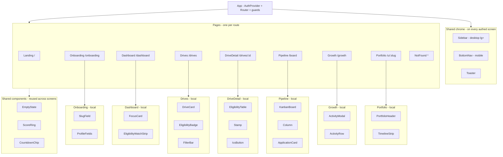

# DriveDeck — Design.md

**The frontend blueprint.** This file is the single source of truth for everything visible: which components exist, what each one renders, what each one is allowed to read or write, and what states it must handle. It is the file open in the second monitor while you write React. It exists to keep the frontend on the rails the PRD set and the Architecture poured — every component here is bound, by name, to its database collection and to the security rule that governs it, so nothing is mismanaged between frontend, backend, and database.

| | |
|---|---|
| **Revision** | v1.1 · 2026-11-08 — adds `/resources` screen (§2.10), GitHub/LinkedIn URL fields (§3.8, §3.22), Google-only auth |
| **Status** | Pre-build. No component code exists yet. Build in the order in `PRD.md` §15.1 / `Architecture.md` Sheet 7. |
| **Companions** | `PRD.md` — product spec (UI copy §7, design tokens §8, acceptance criteria per feature §6). `Architecture.md` — system blueprint (rules Sheet 4, listeners Sheet 5.3, lifecycles Sheet 6). |
| **Live target** | `drivedeck.pages.dev` — mobile-first, tested at 375 px. |

---

## Sheet 0 — Title sheet: how to read this file

### 0.1 Sources of truth (precedence order)

| # | Source | Owns |
|---|---|---|
| 1 | `firestore.rules` in the repo | Security rules — canonical |
| 2 | `Architecture.md` | System structure, route map, listeners, lifecycles |
| 3 | **This file** | Every visual detail: component inventory, props, states, mobile behavior, and the FE↔BE↔DB binding per component |
| 4 | `PRD.md` | UI copy strings (§7), design tokens (§8), feature acceptance criteria (§6), seed data values (§12) |

Where this file and `PRD.md` both speak about design tokens, the values are identical by design; if they ever drift, fix the lower-precedence copy. Where this file and `Architecture.md` both describe a component, this file is the deeper spec.

### 0.2 Glossary (frontend-specific terms)

| Term | Meaning |
|---|---|
| **Screen** | One route — one entry in the router. Spec'd in Sheet 2. |
| **Component** | One React file under `src/components/` or co-located in a page. Spec'd in Sheet 3. |
| **Shared component** | A component used on more than one screen (ScoreRing, CountdownChip, EmptyState). Lives in `src/components/`. |
| **Local component** | A component used on one screen only. Co-located in its page file unless it grows past ~80 lines. |
| **Triple table** | The 3-row Frontend / Backend / Database binding that appears on every component spec in Sheet 3. |
| **7-state coverage** | Every interactive component spec'd across hover · focus · active · disabled · loading · empty · error. |
| **Mockup ref** | The PNG in `upload/` that the screen's visual hierarchy is matched to. Always read with the known-fixes notes. |

### 0.3 The No-Mock-Data rule (front-loaded because it is non-negotiable)

**No component, page, hook, or test in this codebase may ship hardcoded sample data.** Every list, every counter, every badge value comes from a real Firestore read. This is the rule that keeps the frontend honest — and the rule the demo lives or dies by, because judges tap sources and follow links.

| Banned | Allowed |
|---|---|
| `const mockDrives = [{ company: 'TCS', … }]` in a component | `onSnapshot(collection(db, 'drives'), …)` reading real seeded documents |
| `if (dev) return <FakeDashboard />` | An empty state (`<EmptyState />`) when the query returns nothing |
| Hardcoded `<DriveCard company="Infosys" />` in JSX | `<DriveCard drive={doc} />` where `doc` came from a listener |
| A "demo mode" toggle that bypasses Firestore | The seeded demo account `/u/kiran` — real documents written by `scripts/seed.mjs` from real source URLs (`PRD.md` §12.5) |
| `const KIRAN_SCORE = 56` in a component | `<ScoreRing value={computeScore(activities, streak)} />` — the score is derived, never stored |

**The single exception** is the loading skeleton — a pulsing placeholder shape with no real data, replaced by the live listener the moment data arrives. Skeletons are not mock data; they are an explicit "no data yet" state.

The full pre-merge checklist is in Sheet 5. Run it before every commit that touches a component.

### 0.4 If you are an AI reading this file

You are being asked to implement, review, or extend the DriveDeck frontend. Hold these facts:

1. **Every component in Sheet 3 has a triple table.** Read it before writing the component — it tells you which collection to read, which rule protects you, and what the user sees. Skipping the triple table is how frontend-backend mismanagement starts.
2. **No mock data, ever.** If you are tempted to write a hardcoded array "just for now", do not. Write the `onSnapshot` listener and an `EmptyState` instead. Sheet 5 has the checklist.
3. **UI strings come verbatim from `PRD.md` §7.** Never invent copy inline. If a string is missing, add it to `PRD.md` §7 first, then use it.
4. **Design tokens come from Sheet 1 of this file** (which mirrors `PRD.md` §8). Do not introduce new colors, radii, or shadows inline.
5. **Mobile-first.** Every component spec includes its 375 px behavior. Build at 375 px first, then adapt to desktop.
6. **Mockups in `upload/` are references, not assets.** Match their visual hierarchy, never crop or ship them as images. Always apply the known-fixes notes in Sheet 2.

---

## Sheet 1 — The map: component tree + design tokens

### 1.1 Component tree (one diagram, the whole frontend)



Read it as: one App shell, three shared utilities (chrome), three shared components (used on 2+ screens), nine pages, and one local cluster per page. Solid lines are ownership; dotted lines are reuse. Nothing else exists in `src/`.

### 1.2 Design tokens (mirror of `PRD.md` §8.1, with the Tailwind utility mapping)

| Token | Hex | Tailwind utility | Used for |
|---|---|---|---|
| primary | #4F46E5 | `bg-brand` · `text-brand` · `border-brand` | Brand, primary buttons, active nav, score ring stroke |
| primary-dark | #4338CA | `bg-brand-dark` | Hover / pressed on primary |
| bg | #F8FAFC | `bg-canvas` | App background |
| surface | #FFFFFF | `bg-surface` | Cards, sheets, modals |
| text | #0F172A | `text-ink` | Primary text |
| text-secondary | #64748B | `text-ink-muted` | Captions, secondary text |
| border | #E2E8F0 | `border-line` | Card borders, dividers, inputs |
| success | #10B981 | `bg-success` · `text-success` | CONFIRMED stamps, "You match", linked checks, Offer column |
| warning | #F59E0B | `bg-warning` · `text-warning` | TENTATIVE stamps, ≤ 7-day deadlines |
| danger | #EF4444 | `bg-danger` · `text-danger` | ≤ 3-day deadlines, failed eligibility, Rejected column |

Token names are namespaced (`brand`, `canvas`, `ink`, `line`) to avoid collision with Tailwind's built-in utilities (`bg-bg` would be unreadable). Every color you write in a className comes from this table — no `text-indigo-600`, no `bg-slate-50`, no inline `style={{ color: '#…' }}`.

### 1.3 Typography (mirror of `PRD.md` §8.2)

- **Family:** Plus Jakarta Sans — weights 400 / 500 / 600 / 700. Loaded from Google Fonts in `index.html`. Fallback: `system-ui, sans-serif`.
- **Scale:**

| Role | Mobile | Desktop | Weight |
|---|---|---|---|
| Display (H1) | 32 / 38 | 40 / 48 | 700 |
| H2 | 24 / 30 | 24 / 30 | 600 |
| H3 | 18 / 24 | 18 / 24 | 600 |
| Body | 15 / 22 | 15 / 22 | 400 |
| Caption | 13 / 18 | 13 / 18 | 500 |

### 1.4 Shape, spacing, shadow, motion

| Token | Value | Tailwind utility |
|---|---|---|
| Card radius | 12 px | `rounded-xl` |
| Input/button radius | 8 px | `rounded-lg` |
| Chips/badges | full-round | `rounded-full` |
| Card padding (mobile / desktop) | 16 / 20 px | `p-4` / `lg:p-5` |
| Section gap | 24 px | `gap-6` |
| Card shadow | `0 1px 2px rgba(15,23,42,0.06)` | `shadow-card` |
| Elevated shadow (sheets/modals) | `0 8px 24px rgba(79,70,229,0.08)` | `shadow-elev` |
| Touch target min height | 44 px | `h-11` |
| Focus ring | 2 px brand, 2 px offset | `focus:ring-2 focus:ring-brand focus:ring-offset-2` |
| Ring animation (score) | 600 ms ease-out, once on mount | keyframes in `src/index.css` |
| Drag transition | 150 ms ease-out | `@dnd-kit` default |
| Confetti (Offer drop) | 1.2 s, one-shot, CSS keyframes | `src/index.css` |

### 1.5 Paste-ready Tailwind config

Drop this into `tailwind.config.js` as the complete file. It is the contract for every className in the codebase.

```js
/** @type {import('tailwindcss').Config} */
module.exports = {
  content: ['./index.html', './src/**/*.{js,jsx,ts,tsx}'],
  theme: {
    extend: {
      colors: {
        brand:   { DEFAULT: '#4F46E5', dark: '#4338CA' },
        canvas:  '#F8FAFC',
        surface: '#FFFFFF',
        ink:     { DEFAULT: '#0F172A', muted: '#64748B' },
        line:    '#E2E8F0',
        success: '#10B981',
        warning: '#F59E0B',
        danger:  '#EF4444',
      },
      fontFamily: {
        sans: ['"Plus Jakarta Sans"', 'system-ui', 'sans-serif'],
      },
      borderRadius: {
        xl: '12px',
        lg: '8px',
      },
      boxShadow: {
        card: '0 1px 2px rgba(15,23,42,0.06)',
        elev: '0 8px 24px rgba(79,70,229,0.08)',
      },
      screens: {
        xs: '375px',
      },
      keyframes: {
        'ring-fill': {
          '0%':   { 'stroke-dashoffset': 'var(--circumference)' },
          '100%': { 'stroke-dashoffset': 'var(--target-offset)' },
        },
        confetti: {
          '0%':   { transform: 'translateY(0) rotate(0)', opacity: '1' },
          '100%': { transform: 'translateY(-120px) rotate(540deg)', opacity: '0' },
        },
      },
      animation: {
        'ring-fill': 'ring-fill 600ms ease-out forwards',
        confetti:    'confetti 1.2s ease-out forwards',
      },
    },
  },
  plugins: [],
};
```

### 1.6 Global `src/index.css` (the only non-Tailwind CSS)

```css
@import url('https://fonts.googleapis.com/css2?family=Plus+Jakarta+Sans:wght@400;500;600;700&display=swap');
@tailwind base;
@tailwind components;
@tailwind utilities;

@layer base {
  html { -webkit-text-size-adjust: 100%; }
  body { @apply bg-canvas text-ink font-sans antialiased; }
  /* no page-level horizontal scroll on any viewport */
  body { overflow-x: hidden; }
}

@layer components {
  .skeleton {
    @apply bg-line/60 rounded-lg animate-pulse;
  }
}
```

No other CSS files. Component-specific styles are Tailwind utilities in JSX. The two keyframes above (`ring-fill`, `confetti`) are the only animations in the product.

---
## Sheet 2 — Screen specs

Each screen below is one router entry. The structure is identical for all nine: purpose, mockup reference with known fixes, layout (mobile then desktop), data binding (one line — full detail in Sheet 3 per component), and the screen-level edge cases. Component deep specs follow in Sheet 3.

### 2.1 Landing  `/`

**Purpose.** Convert a visitor into a signup within 10 seconds; prove the product before login via the live demo portfolio.

**Mockup ref.** None yet — this screen is built from `PRD.md` §7 copy strings and the Sheet 1 tokens. Visual hierarchy: hero (tagline H1 + support line + two CTAs) above the fold, then 3 feature cards, then a trust strip, then footer.

**Layout.**
- Mobile (375 px): single column, 20 px page padding. Hero stacked (H1, support line, primary CTA full-width, secondary CTA full-width). Cards stack vertically with 16 px gap. Bottom nav hidden on Landing (it's pre-auth).
- Desktop (lg+): max-width container 1024 px, centered. Top nav (logo left, links right, "Get started" button). Hero centered with H1 at 40 px. Cards in a 3-column grid.

**Data binding.** None — fully static. The only dynamic check is `auth.currentUser`: if present, `<Navigate to="/dashboard" replace />`. The "See a live portfolio" link is a plain `<Link to="/u/kiran">`.

**Edge cases.**
- Logged-in visitor → redirect to `/dashboard` (no flash of Landing).
- Slow network → Google Fonts fallback to `system-ui` — design must look acceptable before the web font arrives.

---

### 2.2 Onboarding  `/onboarding`

**Purpose.** From zero to a useful account in under 2 minutes: a profile the eligibility engine can use, and a portfolio slug the student chose.

**Mockup ref.** None yet — built from `PRD.md` §7 (Onboarding block) and Sheet 1 tokens.

**Layout.**
- Mobile: single card, 16 px padding, centered with 24 px page padding. Progress dots "Step N of 3" at top. Step 1 = profile fields stacked; step 2 = slug field with live preview `drivedeck.pages.dev/u/…`; step 3 = 3-item checklist + "Go to dashboard" button.
- Desktop: same card, max-width 480 px, centered vertically.

**Data binding.**
- Step 1 writes nothing yet — local state only.
- Step 3 commit: one batch — `setDoc(users/{uid}, profile)` + `setDoc(usernames/{slug}, { uid })` with `.create()` semantics (fails if slug taken).

**Edge cases.**
- Slug taken → inline message "kiran is taken — try kiran_26 or add your batch year." Continue disabled.
- Reserved slug (`kiran`, `admin`, `api`, `login`, `u`, `drivedeck`) → rejected client-side before the write.
- Refresh mid-flow → guard reads `users/{uid}`; if profile incomplete, resume at the unfinished step (state derived from Firestore, not localStorage).
- Popup blocked during Google sign-in (shouldn't happen here — sign-in happens on Landing — but if a session expires mid-onboarding, fall back to `signInWithRedirect`).

---

### 2.3 Dashboard  `/dashboard`

**Purpose.** Answer in five seconds on a phone: *How ready am I, what's urgent, what should I do next?*

**Mockup ref.** `upload/DriveDeck Placement Prep Dashboard.png` (scored 9/10). Match its hierarchy: greeting → score ring + streak → next deadlines → Today's Focus. **Known fixes:** none on this mockup — it is the cleanest of the set; build to match.

**Layout.**
- Mobile (375 px): single column. Greeting H2 → ScoreRing (centered, 120 px) with streak chip below → next deadlines (up to 3 CountdownChips, full-width rows) → Today's Focus (up to 3 FocusCards, stacked) → EligibilityWatchStrip (full-width).
- Desktop (lg+): 12-column grid. Left 4 columns: ScoreRing + streak + "How this is calculated" link. Right 8 columns: deadlines (top), focus cards (3-column grid), watch strip (bottom).

**Data binding.** Four parallel listeners mount on enter (`Architecture.md` Sheet 5.3):
1. `users/{uid}` → greeting name + eligibility numbers
2. `drives` ordered by `regDeadline` where upcoming → CountdownChip data
3. `applications` where `uid` → board summary (count by stage)
4. `activities` where `uid` → score + streak + focus suggestions

**Edge cases.**
- New account (0 activities, 0 applications): ScoreRing shows 0, focus falls back to "Your portfolio has no projects yet — one is worth 15 points.", deadlines strip still renders from seeded drives.
- No upcoming drives at all: deadlines block shows `<EmptyState>` with "No drives match these filters yet. Try All drives." — not a blank area.
- All four listeners loading on first paint: skeleton cards (pulse), never a fullscreen spinner.

---

### 2.4 Drives  `/drives`

**Purpose.** The trusted replacement for WhatsApp forwards: every drive, its real deadline, whether Kiran qualifies, and the source to prove it.

**Mockup ref.** `upload/DriveDeck Placement Deadline Tracker.png` (scored 9.5/10). Match the verification stamps ("Verified · source: tcs.com · checked Nov 8") and the red "✗ CGPA below" badges. **Known fixes:** the mockup uses a checkmark "✗" character — replace with the lucide `X` icon at 16 px in `text-danger`, never a Unicode glyph. The mockup's "Verified" word matches `PRD.md` §7's "CONFIRMED · source: {domain} · checked {date}" — use the §7 string verbatim.

**Layout.**
- Mobile: FilterBar sticky at top (chips: All · Match me · On campus · Off campus + search input). Below, DriveCards as full-width stacked rows with 12 px gap. Each card: company initials avatar (40 px circle, brand-tinted), company + program (H3), role (caption), deadline CountdownChip, status/eligibility badges.
- Desktop (lg+): FilterBar at top, cards in a 2-column grid below (max-width 1024 px). Same card layout, slightly more breathing room.

**Data binding.** One listener: `drives` ordered by `regDeadline`. Filter (`Match me`, on/off campus, search) is client-side via `checkEligibility(profile, drive)` from `src/lib/eligibility.ts` and string matching.

**Edge cases.**
- Incomplete profile numbers (e.g., CGPA blank) → EligibilityBadge shows "Add your CGPA to check" with a link to onboarding step 1.
- Expired drive (`regDeadline` past) → CountdownChip shows "Closed", card sorts to bottom, excluded from Match me.
- TENTATIVE rows never silently mixed with CONFIRMED — amber dot prefix on the card + the Stamp line on detail.
- Empty filter result → `<EmptyState>` "No drives match these filters yet. Try All drives."

---

### 2.5 DriveDetail  `/drives/:id`

**Purpose.** One drive in full: eligibility table, rounds breakdown, salary/openings, the source stamp, and the actions (save, calendar, official page).

**Mockup ref.** Derive from `upload/DriveDeck Placement Deadline Tracker.png` — the detail view is the row expanded. Build the eligibility table as a stacked list on mobile (see Layout).

**Layout.**
- Mobile: single column. Header (avatar + company + program + role + type chip) → CountdownChip (large) → Stamp line → eligibility as stacked rows ("10th: need 60 · you have 89" with pass/fail icon) → rounds info (card, body text) → salary/openings (two small cards side by side) → action buttons stacked full-width (View official page, Save to board, Add to calendar .ics).
- Desktop (lg+): max-width 800 px centered. Header at top. Two-column middle: left = eligibility + rounds, right = stamp + salary/openings + actions. Actions as a row of three buttons.

**Data binding.** Two reads on mount:
1. `drives/{id}` → all fields
2. `applications/{uid}_{id}` → existence check (determines "Save to board" vs "Saved" state)

**Edge cases.**
- `regDeadline` is `null` (TENTATIVE) → CountdownChip shows "Date unconfirmed", "Add to calendar" disabled with tooltip "Date not yet confirmed by the source".
- Drive doc doesn't exist (bad ID or deleted) → `<Navigate to="/drives" />` with a toast "That drive is no longer available."
- Already saved → primary button shows "Saved" (success color), disabled; secondary "Remove from board" appears.

---

### 2.6 Pipeline  `/board`

**Purpose.** One honest look at "where do I stand": every application as a card, drag it forward as reality advances.

**Mockup ref.** `upload/DriveDeck My Pipeline Kanban Board.png` (scored 9/10). Match the column headers (Saved · Applied · Test/OA · Interview · Offer · Rejected), the "Drop here" empty hint, and the confetti-offer card. **Known fixes:** the mockup shows a "Pro Plan" upsell card — cut it (out of scope, `PRD.md` §14). The mockup's column labels match `PRD.md` §7 exactly — use those strings.

**Layout.**
- Mobile (375 px): six columns as horizontal snap-scroll panels. Each panel is ~280 px wide, full viewport height minus nav. Snap points at panel boundaries. Column header sticky at top of each panel. Cards stacked vertically within panel with 8 px gap.
- Desktop (lg+): six equal columns in a row, max-width 1280 px. Each column has a header (name + count) and a scrollable card list (max-height: calc(100vh - 200px), internal scroll). Page itself does not scroll vertically — only columns do.

**Data binding.** One listener: `applications` where `uid == me` ordered by `updatedAt desc`. The single listener feeds all six columns — group client-side by `status`.

**Edge cases.**
- Empty board (new user) → each column shows its empty hint ("Drop here once you've applied."), the Saved column additionally shows a CTA card "Save a drive and it will appear here as a card." linking to `/drives`.
- Drag to same column → no-op, no write.
- Drag to Offer → confetti fires once (CSS animation, not on every render of an Offer card).
- Offline mid-drag → `@dnd-kit` completes visually, write queues, toast "You're offline — changes will retry when you're back."

---

### 2.7 Growth  `/growth`

**Purpose.** USP 2's input side: log evidence once with its link; the portfolio updates itself.

**Mockup ref.** None dedicated. Derive the activity list visual from the portfolio mockup's activity cards (next screen) — same card, with an "edit/delete" affordance added for the owner.

**Layout.**
- Mobile: page header ("Growth" H2 + readiness mini-ring 48 px on the right) → activity list grouped by month (sticky month headers) → floating action button "Add evidence" bottom-right, 56 px circle, brand color, 16 px above BottomNav. ActivityModal opens as a bottom sheet (slides up from bottom, full-width, rounded top).
- Desktop (lg+): max-width 800 px centered. Header same. List same. FAB becomes a top-right primary button "Add evidence". Modal opens centered, max-width 480 px.

**Data binding.** One listener: `activities` where `uid == me` ordered by `date desc`. Score recompute is pure (`src/lib/scoring.ts`) on every snapshot.

**Edge cases.**
- 0 activities → `<EmptyState>` "No evidence yet. Your first project is worth 15 points." + a button "Log your first" that opens ActivityModal.
- Link field left empty → save disabled, error string "A link is required — that's the evidence rule." (`PRD.md` §7).
- Link fails regex `https?://.+` → same error string.
- Network error on save → toast "You're offline — changes will retry when you're back.", modal stays open with input preserved.

---

### 2.8 Portfolio  `/u/:slug`  (public, no auth)

**Purpose.** USP 2's output side: a public live portfolio that builds itself from the evidence log. This is the screen the demo ends on.

**Mockup ref.** `upload/Rahul Sharma's DriveDeck Portfolio Dashboard.png` (scored 10/10). Match the badge "All evidence linked" (rename to "Every item evidence-linked" per `PRD.md` §7), the GitHub/Live buttons on project cards, and the Growth Timeline strip. **Known fixes — read carefully:**
1. **Rename "Rahul Sharma" → "Kiran"** everywhere on this screen. The mockup was generated before the persona was finalized; the canonical persona is Kiran (`PRD.md` §2, `Architecture.md` Sheet 0.1).
2. The mockup's badge says "All evidence linked" — use the §7 string "Every item evidence-linked" instead.
3. The mockup may show sections for content types the user has no evidence for — in production, sections appear **only** where evidence exists. An empty section is a build defect.
4. Mockup's "Growth Timeline" → render as `TimelineStrip` (12-month bar strip, pure CSS, no chart library).

**Layout.**
- Mobile (375 px): single column. PortfolioHeader (avatar 64 px + name H1 + sub-line + readiness ring 64 px + "Every item evidence-linked" badge + "How this is calculated" link) → sections in order: Projects, Certifications & courses, DSA consistency, Achievements, Growth timeline. Each section: H3 + cards. Footer line at bottom.
- Desktop (lg+): max-width 900 px centered. Header same but wider. Sections in a 2-column grid (Projects full-width; Certifications + DSA side by side; Achievements + Timeline side by side).

**Data binding.** Three chained reads (no listener — public page, render once on mount, no realtime needed for a public profile view):
1. `usernames/{slug}` → `uid` (miss → NotFound)
2. `users/{uid}` → profile + eligibility
3. `activities` where `uid == X` ordered by `date desc` → all sections

**Edge cases.**
- Slug not found → `<NotFound>` with the portfolio-specific copy (`PRD.md` §7): "This portfolio doesn't exist (yet)." + button "Claim your own".
- Empty portfolio (0 activities) → header renders + body shows "Kiran hasn't logged evidence yet." + the "Every item evidence-linked" badge is hidden (no items to back it).
- Link button label auto-picks from URL host: `github.com` → "GitHub", `vercel.app`/`netlify.app`/`*.vercel.app` → "Live", else → "Credential".
- Share button → Web Share API on mobile (`navigator.share`), copy-link toast "Portfolio link copied" fallback on desktop/no-support.

---

### 2.10 Resources  `/resources`  (public, pre-login — v1.1)

**Purpose.** Give a visitor with no account real value immediately — the "before logging they have the resources" requirement. Fully public, linked from Landing nav.

**Mockup ref.** None. Built from `PRD.md` §10.1 strings and Sheet 1 tokens.

**Layout.** Mobile: single column, H1 "Prep resources that actually help.", sub-line, then link cards stacked (title, one-line "why" caption, external-link icon). Desktop: max-width 800 px centered, cards in a 2-column grid.

**Data binding.** None — static page, but **no dummy entries**: every link is one the builder verified by hand (~8: LeetCode, Roadmap.sh, official company career pages, SQL practice). `rel="noopener"` on every link.

**Edge cases.** None — static. Lives in the router as a public route alongside `/` and `/u/:slug`.

---

### 2.9 NotFound  `*`

**Purpose.** Catch every unmatched route, including bad portfolio slugs that aren't claimed by the Portfolio page's own 404 state.

**Mockup ref.** None. Built from `PRD.md` §7 (404 block) and Sheet 1 tokens.

**Layout.** Centered card, max-width 400 px. H1 "404" in display size, body "This page doesn't exist.", button "Back to home" → `/`.

**Data binding.** None.

**Edge cases.** None — fully static.

---
## Sheet 3 — Component deep specs

Every component in the tree (Sheet 1.1) gets a block here. The block format is fixed:

> **Purpose** · **Used in** · **Props** · **States** (if interactive — 7 rows) · **Mobile (375 px)** · **FE / BE / DB** (3-row triple table) · **Edge cases**

The triple table is the contract: it says what the frontend renders, which security rule protects the write, and which collection/query/fields the data comes from. Read it before writing the component.

Component order: shared chrome → shared components → onboarding → dashboard → drives → drive detail → pipeline → growth → portfolio.

---

### 3.1 `Sidebar`  (shared chrome, desktop)

**Purpose.** Primary navigation on desktop lg+. Hidden on mobile (BottomNav takes over).

**Used in.** Dashboard, Drives, DriveDetail, Pipeline, Growth. Not on Landing, Onboarding, Portfolio (public), NotFound.

**Props.**

| Prop | Type | Notes |
|---|---|---|
| `current` | `'dashboard' \| 'drives' \| 'board' \| 'growth'` | Highlights active item |
| `portfolioSlug` | string | "Portfolio" item links to `/u/{slug}` |

**States.**

| State | Behavior |
|---|---|
| hover | Item bg → `bg-canvas`, text → `text-ink`, 150 ms |
| focus | 2 px brand ring |
| active | Item text → `text-brand`, left 3 px brand bar |
| disabled | n/a (all items always enabled once authed) |
| loading | n/a |
| empty | n/a |
| error | n/a |

**Mobile.** Hidden below `lg`. BottomNav replaces it.

**FE / BE / DB.**

| Layer | This component |
|---|---|
| Frontend | Renders 4 nav items + active indicator. Clicking navigates via `react-router` `<Link>`. |
| Backend | None — pure navigation. Auth guard on the route is the real protection. |
| Database | None — reads no collections. `portfolioSlug` is passed in from the page (which read `users/{uid}`). |

**Edge cases.** `portfolioSlug` not yet set (mid-onboarding) → "Portfolio" item hidden. Should never happen post-onboarding (guard prevents).

---

### 3.2 `BottomNav`  (shared chrome, mobile)

**Purpose.** Primary navigation on mobile. Fixed at bottom, one-thumb reach.

**Used in.** Same as Sidebar.

**Props.** Same as Sidebar.

**States.**

| State | Behavior |
|---|---|
| hover | n/a (touch device) |
| focus | 2 px brand ring on tap |
| active | Icon + label → `text-brand` |
| disabled | n/a |
| loading | n/a |
| empty | n/a |
| error | n/a |

**Mobile.** Fixed `bottom-0 inset-x-0`, height 56 px, `bg-surface` with top border `border-line`. 4 equal-width items, each icon (20 px) + label (11 px). Safe-area inset padding (`padding-bottom: env(safe-area-inset-bottom)`).

**FE / BE / DB.** Same as Sidebar — pure navigation, no data.

**Edge cases.** iOS Safari bottom bar overlap → safe-area padding handles it. Active item should not be covered by the home indicator.

---

### 3.3 `Toaster`  (shared chrome)

**Purpose.** Single global toast surface. Every transient message goes through here.

**Used in.** App root — always mounted.

**Props.**

| Prop | Type | Notes |
|---|---|---|
| (none — reads from a `useToast()` hook) | | Hook exposes `toast({ message, variant })` |

**States.**

| State | Behavior |
|---|---|
| hover | n/a (auto-dismiss) |
| focus | n/a |
| active | n/a |
| disabled | n/a |
| loading | n/a |
| empty | No toasts → renders nothing |
| error | Toast variant `error` → `bg-danger` bg, white text |

Toast variants: `success` (success icon, `bg-surface` + `border-success`), `info` (info icon, `bg-surface` + `border-line`), `error` (danger icon, `bg-surface` + `border-danger`).

**Mobile.** Top-anchored, full-width minus 16 px margins, slides down from top, 3 s auto-dismiss (4 s for error).

**FE / BE / DB.**

| Layer | This component |
|---|---|
| Frontend | Renders queued toasts, auto-dismiss timer, swipe-to-dismiss on mobile. |
| Backend | None. |
| Database | None. Toasts are ephemeral UI state, never persisted. |

**Edge cases.** Multiple toasts queue vertically; max 3 visible, older ones dismissed. Toast during offline write → "You're offline — changes will retry when you're back" stays until online event.

---

### 3.4 `EmptyState`  (shared)

**Purpose.** Every list's "no data yet" state. A blank panel is a build defect.

**Used in.** Dashboard (deadlines), Drives (filter result), Pipeline (each column), Growth (no activities), Portfolio (no evidence).

**Props.**

| Prop | Type | Notes |
|---|---|---|
| `message` | string | From `PRD.md` §7 — never invented inline |
| `action?` | `{ label: string, to: string }` | Optional CTA |

**States.** None — static render.

**Mobile.** Full-width card, centered text, 48 px icon above message, optional button below.

**FE / BE / DB.**

| Layer | This component |
|---|---|
| Frontend | Renders message + optional action. |
| Backend | None. |
| Database | None — the parent component already knows the query returned empty. |

**Edge cases.** `message` missing → throw at render time (catches a forgotten prop in dev).

---

### 3.5 `ScoreRing`  (shared)

**Purpose.** Visualize the Readiness Score 0–100 as an animated SVG ring. Used on Dashboard (120 px) and Portfolio (64 px).

**Used in.** Dashboard, Portfolio.

**Props.**

| Prop | Type | Notes |
|---|---|---|
| `value` | number | 0–100, computed by `src/lib/scoring.ts` |
| `size` | number | 64 (portfolio) or 120 (dashboard) |
| `showLink?` | boolean | "How this is calculated" link below (dashboard only) |

**States.**

| State | Behavior |
|---|---|
| hover | n/a (not interactive itself; the link below is) |
| focus | n/a |
| active | n/a |
| disabled | n/a |
| loading | Skeleton ring (pulse) until first `value` arrives |
| empty | `value === 0` → ring renders empty, "0/100" shown, not hidden |
| error | n/a — value is derived client-side, can't fail |

**Mobile.** Scales with `size` prop. Number text 24 px (size 120) or 14 px (size 64).

**FE / BE / DB.**

| Layer | This component |
|---|---|
| Frontend | SVG circle, stroke-dasharray animated on mount via `ring-fill` keyframe (Sheet 1.4). Number text centered. Color: `text-brand` for stroke, `text-ink` for number. |
| Backend | None — score is computed client-side. |
| Database | Reads nothing itself. Parent passes `value` computed from `activities` (rule 5 allows public read). |

**Edge cases.** `value > 100` (shouldn't happen — `min(100, …)` in scoring.ts) → clamp to 100. `value < 0` → clamp to 0.

---

### 3.6 `CountdownChip`  (shared)

**Purpose.** Compact "{Company} {Program} closes in {n}d" pill with urgency color.

**Used in.** Dashboard (next deadlines), DriveDetail (large variant).

**Props.**

| Prop | Type | Notes |
|---|---|---|
| `company` | string | e.g. "TCS" |
| `program` | string | e.g. "NQT" |
| `deadline` | Date \| null | null → "Date unconfirmed" |
| `tentative?` | boolean | TENTATIVE → amber dot prefix |
| `size?` | `'sm' \| 'lg'` | sm on dashboard, lg on detail |

**States.**

| State | Behavior |
|---|---|
| hover | `bg-canvas` if clickable (dashboard → links to drive) |
| focus | 2 px brand ring |
| active | `bg-line` |
| disabled | `opacity-50` (used when "Add to calendar" disabled on null deadline) |
| loading | Skeleton pill |
| empty | n/a (the chip itself is the empty representation of "no deadline") |
| error | n/a |

**Mobile.** Full-width row on sm, full-width card on lg. Color: `> 7 days` → `text-ink-muted` on `bg-canvas`; `≤ 7 days` → `text-warning` on `bg-warning/10`; `≤ 3 days` → `text-danger` on `bg-danger/10`; closed → `text-ink-muted` strikethrough.

**FE / BE / DB.**

| Layer | This component |
|---|---|
| Frontend | Computes days remaining from `deadline` vs `new Date()`. Renders pill. |
| Backend | None. |
| Database | Reads nothing. Parent passes `deadline` from `drives/{id}.regDeadline` (rule 3 allows public read). |

**Edge cases.** `deadline` null → "Date unconfirmed" in `text-ink-muted`, no countdown number. Deadline passed → "Closed". Deadline is today → "closes today".

---

### 3.7 `SlugField`  (onboarding local)

**Purpose.** The portfolio URL picker with live availability check.

**Used in.** Onboarding step 2.

**Props.**

| Prop | Type | Notes |
|---|---|---|
| `value` | string | Controlled |
| `onChange` | (v: string) => void | |
| `status` | `'idle' \| 'checking' \| 'available' \| 'taken' \| 'invalid'` | From parent's debounced check |

**States.**

| State | Behavior |
|---|---|
| hover | Border → `border-ink-muted` |
| focus | Border → `border-brand`, 2 px brand ring |
| active | (typing) |
| disabled | Until step 1 complete |
| loading | `status === 'checking'` → spinner right-aligned, "Checking…" caption |
| empty | `value === ''` → placeholder "yourname", caption "Your portfolio will live at drivedeck.pages.dev/u/" |
| error | `status === 'taken'` → "kiran is taken — try kiran_26 or add your batch year." / `status === 'invalid'` → "Use 3–20 lowercase letters, numbers or underscores." |

**Mobile.** Full-width input, 44 px height. Preview line below: `drivedeck.pages.dev/u/{value or 'yourname'}` in `text-ink-muted`, the slug portion in `text-ink` if available, `text-danger` if taken.

**FE / BE / DB.**

| Layer | This component |
|---|---|
| Frontend | Controlled input + preview + status caption. Debounced 300 ms before check. |
| Backend | Reads `usernames/{slug}` (rule 2 allows public read) — doc exists → "taken", missing → "available". |
| Database | `usernames/{slug}` — single get per check. The actual claim is a `.create()` write that fails if taken (the guarantee, Sheet 4 rule 2). |

**Edge cases.** Reserved slugs (`kiran`, `admin`, `api`, `login`, `u`, `drivedeck`) rejected client-side before the read. Regex `^[a-z0-9_]{3,20}$` enforced client-side; rules do not enforce format (a deliberate gap — the only writer is the onboarding form).

---

### 3.8 `ProfileFields`  (onboarding local)

**Purpose.** Step 1 form: name, college, branch, year, target role, 10th/12th/CGPA/backlogs — plus the two optional profile URLs (v1.1).

**Used in.** Onboarding step 1.

**Props.**

| Prop | Type | Notes |
|---|---|---|
| `value` | Profile object | Controlled — includes `githubUrl`, `linkedinUrl` (optional, v1.1) |
| `onChange` | (p: Profile) => void | |
| `errors` | Partial<Record<keyof Profile, string>> | Per-field validation |

**States.** Standard input states per field (hover/focus/active/disabled/error). Branch is a `<select>` with fixed codes (`CSE, IT, ECE, EEE, MECH, CIVIL, OTHER`). Target role is a chip selector (5 options).

**Mobile.** All fields stacked, 16 px gap. Inputs full-width, 44 px height. Number inputs use `inputMode="decimal"` for CGPA/percentages. GitHub/LinkedIn URL inputs (v1.1) have `inputMode="url"`, helper text from `PRD.md` §10.1, and validate `^https://(github\.com/|linkedin\.com/in/)` — empty allowed.

**FE / BE / DB.**

| Layer | This component |
|---|---|
| Frontend | Controlled form, local validation (numbers in range, required fields). |
| Backend | None until commit. On commit, `users/{uid}` write (rule 1: owner-only). |
| Database | Writes `users/{uid}` with all fields. Branch codes must match `drives.eligibility.branches[]` codes exactly — both use the same fixed list. |

**Edge cases.** CGPA > 10 or < 0 → error "CGPA must be between 0 and 10". Percentages > 100 or < 0 → error. Backlogs negative → error.

---

### 3.9 `FocusCard`  (dashboard local)

**Purpose.** One "Today's focus" suggestion card.

**Used in.** Dashboard.

**Props.**

| Prop | Type | Notes |
|---|---|---|
| `kind` | `'log_dsa' \| 'deadline_drive' \| 'add_project' \| 'all_clear'` | Determines icon + copy |
| `payload` | `{ streakDays?: number, company?: string, program?: string, daysLeft?: number }` | For string interpolation |

**States.**

| State | Behavior |
|---|---|
| hover | `shadow-elev`, 150 ms |
| focus | 2 px brand ring (the card is a button) |
| active | `bg-canvas` |
| disabled | n/a |
| loading | Skeleton card |
| empty | n/a (the `all_clear` kind is the empty representation) |
| error | n/a |

**Mobile.** Full-width card, 16 px padding, icon left (32 px circle brand-tinted), title + body right. Tappable → navigates to the relevant screen.

**FE / BE / DB.**

| Layer | This component |
|---|---|
| Frontend | Renders icon + interpolated copy from `PRD.md` §7. Tap → navigate. |
| Backend | None. |
| Database | Reads nothing. Parent (Dashboard) computed `kind` + `payload` from activities + drives + applications listeners. |

**Edge cases.** `payload` missing a field the copy needs → throw in dev (catches logic bugs).

---

### 3.10 `EligibilityWatchStrip`  (dashboard local)

**Purpose.** One-line strip: "{n} upcoming drives match your profile" → taps to Drives with Match me pre-applied.

**Used in.** Dashboard.

**Props.**

| Prop | Type | Notes |
|---|---|---|
| `count` | number | From parent's eligibility pass over drives |
| `onTap` | () => void | Navigate to `/drives?filter=match` |

**States.**

| State | Behavior |
|---|---|
| hover | `bg-canvas` |
| focus | 2 px brand ring |
| active | `bg-line` |
| disabled | n/a |
| loading | Skeleton strip |
| empty | `count === 0` → "No drives match your profile yet. Browse all drives." (different copy, still tappable) |
| error | n/a |

**Mobile.** Full-width strip, 12 px padding, brand-tinted left border (3 px), text + chevron right.

**FE / BE / DB.**

| Layer | This component |
|---|---|
| Frontend | Renders count + copy + chevron. Tap → navigate. |
| Backend | None. |
| Database | Reads nothing. Parent passes `count` from running `checkEligibility` over the `drives` listener. |

**Edge cases.** `count` negative → clamp to 0. `count` very large (> 50) → display "50+" (shouldn't happen with 8 seeded drives, but defensive).

---

### 3.11 `DriveCard`  (drives local)

**Purpose.** One drive as a row/card in the Drives list.

**Used in.** Drives list.

**Props.**

| Prop | Type | Notes |
|---|---|---|
| `drive` | Drive doc | Full denormalized drive |
| `eligibility` | `{ match: boolean, checks: Check[] }` | From `checkEligibility(profile, drive)` |

**States.**

| State | Behavior |
|---|---|
| hover | `shadow-elev`, 150 ms |
| focus | 2 px brand ring (card is a Link) |
| active | `bg-canvas` |
| disabled | n/a |
| loading | Skeleton card (pulse) |
| empty | n/a |
| error | n/a |

**Mobile.** Full-width card, 16 px padding. Row 1: avatar (40 px) + company/program H3 + role caption. Row 2: CountdownChip sm + EligibilityBadge. Row 3 (if TENTATIVE): amber dot + "TENTATIVE — date unconfirmed".

**FE / BE / DB.**

| Layer | This component |
|---|---|
| Frontend | Renders avatar (initials + color from `drive.initials`/`drive.color`), text, chip, badge. Card is a `<Link to="/drives/{id}">`. |
| Backend | None — read-only. |
| Database | Reads nothing. Parent passes `drive` from the `drives` listener (rule 3: public read). |

**Edge cases.** `drive.regDeadline` null → CountdownChip handles. Expired drive → card opacity 60%, "Closed" chip.

---

### 3.12 `EligibilityBadge`  (drives local)

**Purpose.** Compact "You match" / "CGPA below 6.0" / "Add your CGPA to check" pill.

**Used in.** DriveCard (list), DriveDetail (header).

**Props.**

| Prop | Type | Notes |
|---|---|---|
| `result` | `{ match: boolean, failedCriterion?: string, missingProfile?: boolean }` | From `checkEligibility` |

**States.** Static render — no interaction. Variants: success (match), danger (fail), warning (missing profile).

**Mobile.** Pill, 6 px padding, full-round. Icon 14 px + text 13 px.

**FE / BE / DB.**

| Layer | This component |
|---|---|
| Frontend | Renders pill with variant color + copy from `PRD.md` §7. |
| Backend | None. |
| Database | Reads nothing. Parent computed `result` from profile (from `users/{uid}`) vs drive (from `drives/{id}`). |

**Edge cases.** `missingProfile` true → warning variant "Add your CGPA to check". `match` true but drive expired → still shows match (the eligibility didn't change), but parent excludes from list.

---

### 3.13 `FilterBar`  (drives local)

**Purpose.** Filter chips + search input for the Drives list.

**Used in.** Drives.

**Props.**

| Prop | Type | Notes |
|---|---|---|
| `filter` | `'all' \| 'match' \| 'on' \| 'off'` | |
| `onFilterChange` | (f) => void | |
| `search` | string | |
| `onSearchChange` | (s) => void | |

**States.** Chip states: hover (bg-canvas), focus (ring), active (bg-brand text-white). Search input: standard states.

**Mobile.** Sticky top, `bg-surface` with bottom border. Chips horizontal scroll (no page-level scroll). Search input full-width below chips, 44 px.

**FE / BE / DB.**

| Layer | This component |
|---|---|
| Frontend | Controlled chips + input. |
| Backend | None. |
| Database | None — filtering is client-side over the drives listener. |

**Edge cases.** Search + filter combine with AND. Empty search → no filter on text.

---

### 3.14 `EligibilityTable`  (drive detail local)

**Purpose.** Per-criterion pass/fail breakdown: "10th: need 60 · you have 89".

**Used in.** DriveDetail.

**Props.**

| Prop | Type | Notes |
|---|---|---|
| `checks` | `Check[]` | `{ label, need, have, pass }` from `checkEligibility` |

**States.** Static. Each row: pass icon (success) or fail icon (danger).

**Mobile.** Stacked rows, NOT a table. Each row: label left, "need X · you have Y" right, icon far right. 12 px row padding.

**FE / BE / DB.**

| Layer | This component |
|---|---|
| Frontend | Renders stacked rows. |
| Backend | None. |
| Database | None — parent passes `checks` from `checkEligibility(profile, drive)`. |

**Edge cases.** `branches` check: if drive allows all branches, show "All branches eligible" without a list. If profile branch not in list, show "Open to: CSE, IT, ECE" + fail icon on the row.

---

### 3.15 `Stamp`  (drive detail local)

**Purpose.** The verification stamp line: "CONFIRMED · source: tcs.com · checked Nov 8, 2026" or "TENTATIVE — date unconfirmed · source: tcs.com".

**Used in.** DriveDetail.

**Props.**

| Prop | Type | Notes |
|---|---|---|
| `status` | `'CONFIRMED' \| 'TENTATIVE'` | |
| `sourceName` | string | e.g. "tcs.com" |
| `verifiedAt` | Date | |
| `sourceUrl` | string | |

**States.** Static. CONFIRMED → success icon + success text. TENTATIVE → warning icon + warning text.

**Mobile.** Full-width card, 12 px padding. Icon + text inline. "View official page" link below, opens `sourceUrl` in new tab with `rel="noopener"`.

**FE / BE / DB.**

| Layer | This component |
|---|---|
| Frontend | Renders stamp + external link. |
| Backend | None — read-only. |
| Database | Reads nothing. Parent passes fields from `drives/{id}` (rule 3: public read). The `sourceUrl` is the USP 1 audit trail — it must be present (rules don't enforce it, but the seed script always sets it; `PRD.md` §12.1). |

**Edge cases.** `verifiedAt` missing → "Not yet verified" (shouldn't happen — seed always sets it). `sourceUrl` missing → hide the link and log an error (data integrity issue).

---

### 3.16 `IcsButton`  (drive detail local)

**Purpose.** Generate and download a `.ics` calendar file for the drive's deadline.

**Used in.** DriveDetail.

**Props.**

| Prop | Type | Notes |
|---|---|---|
| `drive` | Drive doc | Uses `regDeadline`, `testDate`, `companyName`, `program` |

**States.**

| State | Behavior |
|---|---|
| hover | `bg-brand-dark` |
| focus | 2 px brand ring |
| active | `bg-brand-dark` scale 0.98 |
| disabled | `regDeadline` null → disabled, tooltip "Date not yet confirmed by the source" |
| loading | n/a (instant) |
| empty | n/a |
| error | n/a |

**Mobile.** Full-width button, 44 px height, brand bg, white text, calendar icon left.

**FE / BE / DB.**

| Layer | This component |
|---|---|
| Frontend | On click, calls `src/lib/ics.ts` to build a Blob, triggers download via `<a href={url} download>`. |
| Backend | None. |
| Database | None — uses drive fields already in memory. |

**Edge cases.** `regDeadline` null → disabled (above). Blob URL revoked after click to avoid memory leak.

---

### 3.17 `KanbanBoard`  (pipeline local)

**Purpose.** The six-column drag-and-drop surface.

**Used in.** Pipeline.

**Props.**

| Prop | Type | Notes |
|---|---|---|
| `applications` | Application[] | All the user's applications, grouped internally |
| `onMove` | (appId, newStatus) => void | Updates Firestore |

**States.** (Board-level, not per-card.)

| State | Behavior |
|---|---|
| hover | n/a (drag handles its own) |
| focus | n/a |
| active | n/a |
| disabled | n/a |
| loading | Skeleton columns |
| empty | All columns show their empty hint; Saved column shows CTA card |
| error | Toast on failed write |

**Mobile.** Horizontal snap-scroll container, 6 panels. Each panel ~280 px wide, `scroll-snap-align: start`. Internal vertical scroll per panel.

**FE / BE / DB.**

| Layer | This component |
|---|---|
| Frontend | `@dnd-kit/core` DndContext, 6 Column children, sensors (Pointer + Touch). On drag end, calls `onMove`. |
| Backend | `applications` write (rule 4: owner-only via ID prefix). The rule is the security — the drag is just UX. |
| Database | Writes `applications/{uid}_{driveId}` — `status`, `history` append, `updatedAt`. Reads via the `applications` listener. |

**Edge cases.** Drag to same column → no-op, no write. Drag to Offer → triggers confetti (one-shot, via a ref guard). Offline mid-drag → optimistic UI, write queues.

---

### 3.18 `Column`  (pipeline local)

**Purpose.** One kanban column with header + card list + drop zone.

**Used in.** KanbanBoard.

**Props.**

| Prop | Type | Notes |
|---|---|---|
| `status` | ApplicationStatus | The column's status |
| `apps` | Application[] | Apps in this column |
| `isDropTarget` | boolean | From dnd-kit |

**States.**

| State | Behavior |
|---|---|
| hover | n/a |
| focus | n/a |
| active | n/a |
| disabled | n/a |
| loading | Skeleton cards |
| empty | "Drop here once you've applied." (or CTA card for Saved) |
| error | n/a |
| isDropTarget | `bg-canvas` + dashed `border-brand` border |

**Mobile.** 280 px wide panel, header sticky, card list scrollable.

**FE / BE / DB.** Inherits from KanbanBoard — no direct DB access.

---

### 3.19 `ApplicationCard`  (pipeline local)

**Purpose.** One application as a draggable card.

**Used in.** KanbanBoard (via Column).

**Props.**

| Prop | Type | Notes |
|---|---|---|
| `app` | Application | Includes `driveId` for resolution |
| `drive` | Drive | Denormalized for display (joined client-side or denormalized on app) |
| `onRemove` | () => void | Confirm dialog → delete |

**States.**

| State | Behavior |
|---|---|
| hover | `shadow-elev`, show "⋯" menu button |
| focus | 2 px brand ring (card is draggable + has menu) |
| active | (being dragged) `opacity-50` + `shadow-elev` |
| disabled | n/a |
| loading | Skeleton card |
| empty | n/a |
| error | n/a |

**Mobile.** Full-width card, 12 px padding. Avatar + company/program + role + "Nd here" chip. Long-press to drag (dnd-kit touch sensor).

**FE / BE / DB.**

| Layer | This component |
|---|---|
| Frontend | Renders card, dnd-kit `useDraggable`, menu with "Remove". |
| Backend | `applications` delete (rule 4: owner-only). |
| Database | `applications/{uid}_{driveId}` delete on remove. The `drive` prop is denormalized — the parent Pipeline page joins `drives` (public read) with `applications` (own read) client-side. |

**Edge cases.** `drive` missing (drive doc deleted from seed) → card shows "Drive no longer available" + remove button still works. "Nd here" computed from `updatedAt` vs now.

---

### 3.20 `ActivityModal`  (growth local)

**Purpose.** The evidence logging form. Enforces the Evidence Rule client-side; rules enforce it server-side as the guarantee.

**Used in.** Growth.

**Props.**

| Prop | Type | Notes |
|---|---|---|
| `open` | boolean | |
| `onClose` | () => void | |
| `onSave` | (activity) => Promise<void> | Calls `addDoc(activities, …)` |

**States.**

| State | Behavior |
|---|---|
| hover | n/a (form) |
| focus | Per-field: 2 px brand ring on focus |
| active | (typing/selecting) |
| disabled | Save button disabled until title + valid URL present |
| loading | Save in flight → button shows spinner, disabled |
| empty | Form opens with empty fields, date defaults to today |
| error | URL missing/invalid → "A link is required — that's the evidence rule." Network error → toast, modal stays open |

**Mobile.** Bottom sheet — slides up from bottom, full-width, rounded top `rounded-t-xl`, max-height 90vh, internal scroll. Backdrop dims page.

**FE / BE / DB.**

| Layer | This component |
|---|---|
| Frontend | Controlled form. Type chips (5). Title input. Summary textarea (140 char counter). URL input with helper text. Tag input (max 3). Date picker. Save/Cancel buttons. |
| Backend | `activities` create (rule 5: owner-only + URL regex `https?://.+`). The rule is the Evidence Rule's guarantee — even if the UI is bypassed, the write fails. |
| Database | Writes `activities/{autoId}` with `{ uid, type, title, summary, url, tags, date, createdAt }`. The `uid` must equal `request.auth.uid` (rule 5). |

**Edge cases.** URL regex `https?://.+` — must include protocol. Tags split on comma, max 3, trimmed. Modal dismiss on backdrop click → confirm "Discard this entry?" if any field filled.

---

### 3.21 `ActivityRow`  (growth + portfolio local)

**Purpose.** One activity as a row. Used in two contexts: owner view (Growth, with edit/delete) and public view (Portfolio, read-only).

**Used in.** Growth, Portfolio.

**Props.**

| Prop | Type | Notes |
|---|---|---|
| `activity` | Activity | |
| `variant` | `'owner' \| 'public'` | Owner shows menu; public shows link buttons |

**States.**

| State | Behavior |
|---|---|
| hover | `bg-canvas` |
| focus | 2 px brand ring (link buttons) |
| active | n/a |
| disabled | n/a |
| loading | Skeleton row |
| empty | n/a |
| error | n/a |

**Mobile.** Full-width card, 12 px padding. Type icon (left, 32 px circle), title + summary + tags (middle), link buttons (right, stacked). Owner variant: "⋯" menu on far right.

**FE / BE / DB.**

| Layer | This component |
|---|---|
| Frontend | Renders icon by `type`, title, summary, tags, link buttons (label from URL host: github.com → "GitHub", vercel/netlify → "Live", else → "Credential"). |
| Backend | Public read (rule 5: `allow read: if true`). Owner variant additionally: update/delete (rule 5: owner-only). |
| Database | Reads `activities` fields. Link buttons open `activity.url` in new tab `rel="noopener"`. |

**Edge cases.** URL host not recognized → "Credential" label. Summary > 140 chars → clamp with ellipsis (shouldn't happen — modal enforces). Tags array empty → hide tag row.

---

### 3.22 `PortfolioHeader`  (portfolio local)

**Purpose.** The top of the public portfolio: name, role, college, readiness ring, "Every item evidence-linked" badge.

**Used in.** Portfolio.

**Props.**

| Prop | Type | Notes |
|---|---|---|
| `user` | User doc | name, targetRole, year, branch, college — plus `githubUrl`, `linkedinUrl` (v1.1) |
| `score` | number | Computed from activities |
| `activityCount` | number | For badge visibility |

**States.** Static. Badge hidden if `activityCount === 0`.

**Mobile.** Centered. Avatar 64 px (initials circle, brand-tinted). Name H1. Sub-line caption. ScoreRing 64 px below. Badge pill below ring. "How this is calculated" link below badge. Share button below.

**FE / BE / DB.**

| Layer | This component |
|---|---|
| Frontend | Renders header + ScoreRing + badge + share button (Web Share API / copy-link). |
| Backend | Public read (rule 1: `users` allow read if true). |
| Database | Reads `users/{uid}` fields. Score computed from `activities` (also public read, rule 5). |

**Edge cases.** `activityCount === 0` → badge hidden (no items to back the claim). Share fails (no Web Share API) → copy-link toast fallback. `githubUrl`/`linkedinUrl` empty (v1.1) → their buttons hidden; if both empty, no link-button row at all.

---

### 3.23 `TimelineStrip`  (portfolio local)

**Purpose.** 12-month bar strip showing activity counts per month. Pure CSS, no chart library.

**Used in.** Portfolio.

**Props.**

| Prop | Type | Notes |
|---|---|---|
| `activities` | Activity[] | All the user's activities |

**States.** Static.

**Mobile.** Full-width card, 12 bars (one per month, oldest left → current right), bar height proportional to count (max bar = max month count), month label below (J F M A …). Brand color bars.

**FE / BE / DB.**

| Layer | This component |
|---|---|
| Frontend | Groups activities by `date` month, counts, renders 12 divs with height % via inline style. |
| Backend | None. |
| Database | Reads nothing — parent passes `activities`. |

**Edge cases.** All months empty → strip renders with 0-height bars + caption "No activity yet." Months with 0 activities render as 2 px baseline (not invisible).

---
## Sheet 4 — Master FE ↔ BE ↔ DB alignment matrix

The single table that answers "who does what" across all three layers, for every component. Read this when you're unsure which layer owns a concern. The rule of thumb: **the frontend renders, the backend (rules) protects, the database (collections) provides** — never the reverse.

| Component | Frontend does | Backend enforces (rule #) | Database provides (collection · query · fields) |
|---|---|---|---|
| Sidebar / BottomNav | Render nav, navigate | Auth guard on route | none |
| Toaster | Render queued toasts | none | none (ephemeral) |
| EmptyState | Render message + CTA | none | none (parent knows it's empty) |
| ScoreRing | SVG ring, animate, display value | none (score is client-derived) | none — parent passes `value` from `activities` |
| CountdownChip | Compute days, render pill with urgency color | none | none — parent passes `drives/{id}.regDeadline` (rule 3 public read) |
| SlugField | Input, debounced check, preview URL | rule 2 (`usernames` create-once) | `usernames/{slug}` get (rule 2 public read); claim via `.create()` |
| ProfileFields | Form, validate, pass to parent on commit | rule 1 (`users` owner-only write) | `users/{uid}` write: name, branch, cgpa, tenth, twelfth, backlogs, targetRole, portfolioSlug |
| FocusCard | Render suggestion, navigate on tap | none | none — parent (Dashboard) computed `kind`+`payload` from 4 listeners |
| EligibilityWatchStrip | Render count, navigate | none | none — parent passes count from `checkEligibility` over `drives` |
| DriveCard | Render card, Link to detail | rule 3 (`drives` public read) | `drives/{id}` denormalized: companyName, program, role, initials, color, regDeadline, status |
| EligibilityBadge | Render pass/fail pill | none | none — parent passes `result` from `checkEligibility(profile, drive)` |
| FilterBar | Chips + search, client-side filter | none | none — operates on drives listener in parent |
| EligibilityTable | Render stacked per-criterion rows | none | none — parent passes `checks` from `checkEligibility` |
| Stamp | Render status + source link | rule 3 (`drives` public read) — the `sourceUrl` field is the USP 1 audit trail | `drives/{id}`: status, sourceName, verifiedAt, sourceUrl |
| IcsButton | Build Blob, trigger download | none | none — uses drive fields in memory |
| KanbanBoard | dnd-kit drag, call onMove | rule 4 (`applications` owner-only via ID prefix) | `applications/{uid}_{driveId}` write: status, history[], updatedAt |
| Column | Render header + cards + drop zone | none (inherits board's rule 4) | none (receives apps from board) |
| ApplicationCard | Draggable card, menu, remove | rule 4 (`applications` owner-only delete) | `applications/{uid}_{driveId}` delete; `drives/{id}` join for display (rule 3 public read) |
| ActivityModal | Form, validate URL client-side, save | rule 5 (`activities` owner-only + `url.matches('https?://.+')` — **the Evidence Rule**) | `activities/{autoId}` create: uid, type, title, summary, url, tags, date, createdAt |
| ActivityRow (owner) | Render + edit/delete menu | rule 5 (`activities` owner-only update/delete) | `activities/{id}` update/delete |
| ActivityRow (public) | Render + link buttons | rule 5 (`activities` public read) | `activities/{id}`: type, title, summary, url, tags, date |
| PortfolioHeader | Render name + ring + badge + share + GitHub/LinkedIn link buttons (v1.1, hidden when empty) | rule 1 (`users` public read) + rule 5 (`activities` public read) | `users/{uid}` (incl. `githubUrl`, `linkedinUrl`) + `activities` where uid |
| Resources page (v1.1) | Render static curated link cards | none — public static page, no data | none |
| TimelineStrip | Group by month, render 12 bars | none | none — parent passes activities |

### 4.1 How to read this matrix when coding

- **Writing a component?** Find its row. The "Database provides" column tells you exactly which collection and fields to read — never read a collection not listed there.
- **Adding a write?** The "Backend enforces" column tells you which rule protects it. If no rule is listed, the write is impossible — add the rule to `firestore.rules` first (and bump `Architecture.md` Sheet 4 + this matrix).
- **Debugging a PERMISSION_DENIED?** Match the component's write against its rule. The most common cause is a mismatch between the doc ID format the frontend writes and the rule's ID-prefix check (e.g., `applications` ID must be `{uid}_{driveId}` — rule 4 splits on `_`).
- **Considering a new component?** It must fit a row here. If it doesn't, either it duplicates an existing component (don't) or it needs a new collection/rule (architectural change — bump the revision on `Architecture.md` and `Design.md`).

### 4.2 The three rules every frontend dev must memorize

These are the rules the frontend interacts with. The other two (rules 1, 2 — profiles and slugs) are touched only by onboarding.

| # | Rule | What the frontend must do |
|---|---|---|
| 3 | `drives` / `companies`: read if true, write if false | **Never attempt a drive/company write from the client.** The seed script is the only writer. If you need a drive added, run `scripts/seed.mjs`. |
| 4 | `applications/{appId}`: read/write if `appId.split('_')[0] == uid` | **Always construct the doc ID as `{uid}_{driveId}`** via `src/lib` helper. Never use a random ID. The rule will deny a write whose ID prefix isn't your uid. |
| 5 | `activities`: public read; create if `uid == auth.uid` AND (`url.matches('https?://.+')` OR `image` matches a `data:image/…;base64,` URI) | **Always include `uid` and proof** — a valid `http(s)://` URL, or an attached compressed image. The rules check both — the Evidence Rule. |

---
## Sheet 5 — No-Mock-Data appendix

The rule was stated in Sheet 0.3. This sheet is the operational version: what's banned, what's allowed, and the checklist to run before every commit that touches a component.

### 5.1 What is mock data (banned)

Any of these in `src/` is a build defect:

```jsx
// BANNED — hardcoded array in a component
const MOCK_DRIVES = [
  { company: 'TCS', deadline: '2026-12-01', … },
  { company: 'Infosys', deadline: '2026-12-15', … },
];
function Drives() {
  return MOCK_DRIVES.map(d => <DriveCard drive={d} />);
}

// BANNED — demo mode toggle
if (import.meta.env.DEV) return <FakeDashboard />;

// BANNED — hardcoded value
<ScoreRing value={56} />

// BANNED — hardcoded component instance with fake data
<DriveCard company="Infosys" deadline="next week" />

// BANNED — fixture file imported into a component
import { mockActivities } from './fixtures';
```

### 5.2 What is not mock data (allowed)

```jsx
// ALLOWED — real Firestore listener
const [drives, setDrives] = useState([]);
useEffect(() => onSnapshot(
  query(collection(db, 'drives'), orderBy('regDeadline')),
  snap => setDrives(snap.docs.map(d => ({ id: d.id, ...d.data() })))
), []);

// ALLOWED — empty state when query returns nothing
if (drives.length === 0) return <EmptyState message="No drives match these filters yet. Try All drives." />;

// ALLOWED — loading skeleton before first snapshot
if (loading) return <div className="skeleton h-16 rounded-xl" />;

// ALLOWED — derived value from real data
const score = computeScore(activities, streakDays);

// ALLOWED — the seeded demo account /u/kiran
// (real documents in Firestore, written by scripts/seed.mjs from real source URLs)
// The frontend reads them the same way as any other portfolio — no special mode.
```

### 5.3 The single exception: design-time storybook fixtures

If you build a component-isolation playground (Storybook or a `/dev` route) to preview states, fixtures may live **only** in `src/dev/fixtures/` and **must never** be imported by a real page. The `/dev` route must be excluded from production builds via a Vite env check. If in doubt, skip the playground — the seeded `/u/kiran` data is sufficient for visual QA.

### 5.4 Pre-merge checklist

Run this before every commit that touches `src/components/` or `src/pages/`. If any box is unchecked, the commit is not ready.

- [ ] No `const MOCK_` / `mock` / `fixture` / `dummy` / `sample` identifier in any file under `src/` (except `src/dev/fixtures/` if used)
- [ ] No hardcoded drive, company, application, or activity object in a component file
- [ ] No `<Component prop="literal_value" />` where the prop should come from data (e.g., no `<ScoreRing value={56} />`)
- [ ] Every list renders from a `useEffect` + `onSnapshot` listener or from props passed by a parent that has one
- [ ] Every empty state uses `<EmptyState>` with a string from `PRD.md` §7 — no inline "No data" text
- [ ] Every loading state uses the `.skeleton` class — no "Loading…" text
- [ ] Every write constructs its document ID via the `src/lib` helper (not a random ID, not a string template inline)
- [ ] Every activity write includes a `url` field matching `https?://.+` (the Evidence Rule)
- [ ] No `if (import.meta.env.DEV) return <Fake />` shortcut anywhere
- [ ] The seeded `/u/kiran` portfolio renders correctly with real Firestore data (manual check after merge)

### 5.5 How to enforce it automatically (optional, recommended)

Add a pre-commit hook (`.husky/pre-commit` or a simple `git` hook) that runs:

```bash
# Fails the commit if banned patterns are found in src/ (excluding src/dev/)
! rg -n 'const\s+(MOCK_|mock_|dummy|sample|fixture)' src/ --glob '!src/dev/**' \
  && ! rg -n 'import\.meta\.env\.DEV.*return\s+<' src/
```

If the `rg` finds a match, the commit is blocked. Adjust the patterns as the codebase grows, but keep the rule strict — the moment mock data ships, the demo's trust claim collapses.

### 5.6 The deeper reason

The product's three USPs (`PRD.md` §5) all depend on the data being real:

- **USP 1 (Verified Drives):** every drive row carries `sourceUrl` + `verifiedAt`. Mock data has no source — a judge tapping "View official page" hits a 404 and the USP dies.
- **USP 2 (Evidence-linked Portfolio):** every activity has a working link. Mock data has dead links — the "Every item evidence-linked" badge becomes a lie.
- **USP 3 (Readiness Score):** the score is computed from evidence. A hardcoded `<ScoreRing value={56} />` is theater, not transparency.

This is why the rule is non-negotiable, and why this appendix exists as a sheet rather than a footnote. The frontend is the visible surface of the trust the backend and database enforce; mock data breaks that surface, and there is no recovery in a live demo.

---

## Closing note

This file, `PRD.md`, and `Architecture.md` travel together in the repo root. They are three views of one building: PRD is the program (what we're building and why), Architecture is the blueprint (how it's structured), Design is the frontend drawing set (what each visible piece looks like and binds to). Any change to scope, tokens, components, or rules requires bumping the revision on all three and re-running the relevant checklists (`Architecture.md` Sheet 9, this file's Sheet 5.4).
